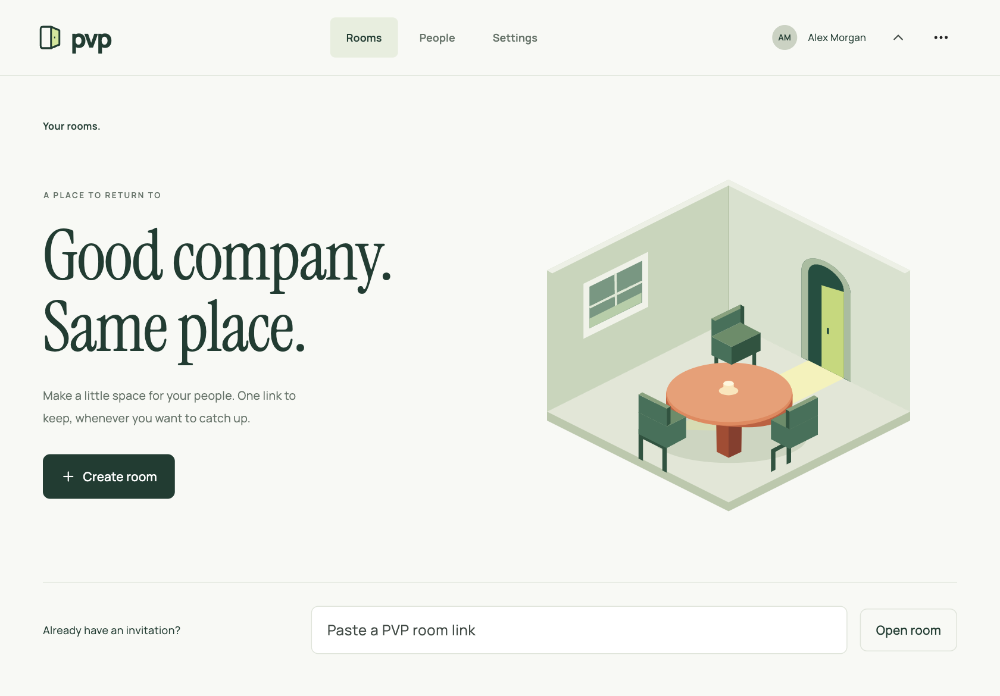
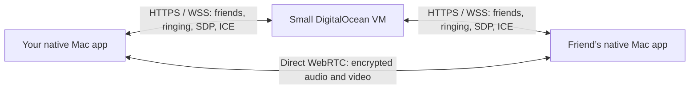

# PVP · A room for your people.

PVP gives small recurring groups a familiar room and one reusable invitation. Create a room, share the link, and come back together. Join to listen, use your microphone, or turn on your camera when you choose. Optional accounts add saved people and direct calling.

The October 31 source upgrade keeps the PVP name and unifies the browser and Mac experience around Rooms. It adds full-window pair video, expandable self previews, mobile layout/keyboard improvements, automatic microphone recovery, measured outgoing quality, muted-sound reminders, and live connection evidence. See [implementation, checks, and remaining device-validation limits](docs/ROOMS-UPGRADE.md). Browser/signaling 0.3.25 is live with the [animated network homepage](docs/NETWORK-FRONT-PAGE.md); native source changes await a new Mac package. Earlier release records below describe their original versions.

**Open PVP.app on your Mac** and choose **Continue as guest**, or create a meeting link in the browser. The app connects to the Rust signaling service at [lopixel.space](https://lopixel.space). With an optional account, share your username for direct calls: Mac friends ring in their menu bar, and browser friends ring while their page is open. Closing the Mac window keeps you available from the menu bar. Original Flutter 1.0.0 installs remain compatible with the updated server.

Build the native app with Flutter 3.41+ / Dart 3.11+, Xcode, and CocoaPods:

```sh
scripts/build-macos.sh
open dist/PVP-macOS-1.0.20/PVP.app
# Install in ~/Applications or /Applications before enabling Launch at login.

cargo run --release                    # launches the native Mac app
cargo run -- --web                     # explicitly choose the browser client
cargo run -- --url http://localhost:8787 # browser client on a local service
```

The native app uses a compiled Flutter interface, AppKit menu-bar/window behavior, macOS Keychain, ServiceManagement login items, and native WebRTC camera, microphone, encoding, and playback. It does not embed a browser or load the website as its interface. macOS 13 or newer is required. See [native app design and build notes](docs/NATIVE.md).

## Features

The browser and Flutter clients open on **Rooms** for both guests and accounts. Reuse the same invitation; leaving stops your devices while other people can stay and you can return later. **People** supports direct calling, with drop-in friend rooms available as a secondary option. Cameras stay off until you enable them. Listen-only entry requests no microphone or camera access. Calls support up to sixteen people through direct peer connections. The shared paper, ink and amber identity uses one generated token source across web and Mac.

- [PVP Signal motion](docs/MOTION.md): fast screen transitions, tactile controls, paired caller waves, and reduced-motion support across Mac and browser clients.
- Persistent [meeting admin roles](docs/MEETING-ADMINS.md), microphone moderation and kicking, with creator-controlled appointments. Admins can optionally require raised hands and approve each speaker; approved participants hear a gentle chime before choosing to unmute.
- Permanent [recurring meeting links](docs/RECURRING-MEETINGS.md), approved member lists and up to sixteen participants across browsers and Macs.
- Persistent accounts, accepted friends, incoming/outgoing requests, friend removal, online presence, and recent calls.
- One-click calling, answer/decline, a 60-second ring window, busy checks, hangup, reconnection, and missed calls. A friend who opens PVP during the ring window can answer.
- Data saver, Balanced, Studio, and custom presets: 360p–1080p, 15–60 fps, outgoing video limits of 128 Kbps–8 Mbps, and audio limits of 24–96 Kbps. Settings apply during calls and persist per account on the device.
- Camera preview and device selection, microphone activity and selection during calls, microphone mute, camera toggle, live outbound statistics, latency, and call duration.
- Echo cancellation enabled by default, with a saved toggle in Settings and call controls on Mac and web, including group calls.
- A live [Connection inspector](docs/CONNECTION-INSPECTOR.md) with reported IPs/ports, selected and tested ICE paths, incoming/outgoing counters, native signaling socket endpoints, local JSON export and endpoint-specific tcpdump commands. Missing addresses are marked unavailable; packet rows are never manufactured.
- A professional Mac interface, native menu-bar quick calling, answer/decline notifications, gentle ringing, optional launch at login, window hiding, and automatic network/wake reconnection. The optional web client also supports mobile layouts.



## Direct peer-to-peer calls



The signaling service exchanges invitations and connection information. It never receives, forwards, records, or decrypts call media. WebRTC uses DTLS-SRTP and STUN to establish an encrypted connection between the two clients. There are **no TURN servers or media-relay fallback** in the new app. Relay candidates are rejected in signaling and checked in selected connection statistics.

Only accepted friends can initiate calls. Only the recipient can answer; only participants in an accepted call can exchange signaling. Removing a friendship ends its active call. The server stores accounts, Argon2id password hashes, hashed session tokens, friendships, and call history. Active signaling stays in memory. The server sees call metadata and network connection details needed for setup.

### Practical limits

- The Mac app remains available with its window closed. Fully quitting, sleeping, or going offline stops real-time ringing. Returning during the 60-second ring window works; missed calls appear later in Recent calls. APNs notifications for a fully quit app are not implemented.
- Strict direct P2P cannot connect through every NAT/firewall combination. The app shows a failure; try another network. It does not silently relay media.
- Bandwidth caps apply to outgoing encoded media. Transport overhead adds traffic, incoming quality is controlled by the friend, and the media engine/camera may deliver less than the requested resolution or frame rate.
- One active client per account. Opening the browser client or another Mac with the same account takes over and ends an existing call. Calls support up to sixteen participants. Password reset is not implemented.
- Local release builds are not notarized. Signing for seamless distribution to other Macs requires a Developer ID certificate and Apple notarization access. Physical camera/microphone capture and calls across separate external networks still need manual verification.

## Security review

See [the security review and validation record](docs/SECURITY.md) for fixes, encryption, certificate verification, compatibility and remaining limits. Flutter 1.0.3 includes the [audio fixes](docs/AUDIO.md) and [Connection inspector](docs/CONNECTION-INSPECTOR.md); previous apps and release archives are backed up. The release script uses the isolated patched SDK when present; `PVP_FLUTTER` and `PVP_OUTPUT_DIR` override SDK/output. Compare verification codes using another trusted channel to check peer certificates.

## Recurring meetings

**No account is needed to create or join a meeting.** Create a link from the browser home screen, or choose **Continue as guest** in the native app. Send it by text, email, or calendar invite. **Open more private Zoom** turns an existing numbered Zoom invitation into a stable PVP meeting and provides a permanent PVP link and a message to share with the group. Everyone must join in PVP; Zoom passcodes and host roles do not transfer. See [guest links, supported Zoom formats, and host identity](docs/GUEST-LINKS-ZOOM.md).

Use **Create meeting link** in the browser or **Meetings → Create permanent link** in the Mac app. Choose **Anyone with the link** for open admission without a friend invitation; guests can enter a display name and join in the browser without an account. Guest-created links are open to anyone with the link; signed-in users can also create private meetings for invited friends. See [open links](docs/OPEN-MEETINGS.md). Copy the link into your weekly calendar event. Approved members can join first without the owner present; opening a link shows a preview and **Join meeting** starts capture. Links never expire and survive service restarts. Restore the database and retain the same domain when moving VMs. See [recurring meetings and portable backups](docs/RECURRING-MEETINGS.md).

## Local development

```sh
cargo run --manifest-path signaling/Cargo.toml
cd desktop
../.build/flutter-security-sdk/bin/flutter run -d macos --dart-define=PVP_SERVICE=http://localhost:8787
# Or choose a service from the native sign-in screen.
# Browser compatibility: http://localhost:8787 in another browser profile.
```

| Environment variable | Default | Purpose |
| --- | --- | --- |
| `PVP_BIND` | `127.0.0.1:8787` | Listener; keep loopback behind an HTTPS proxy |
| `PVP_ORIGIN` | `http://localhost:8787` | Exact origin for HTTP writes and WebSocket upgrades |
| `PVP_DATABASE` | `pvp.sqlite` | Persistent SQLite database, WAL enabled |
| `PVP_URL` | `https://lopixel.space` | Optional browser launcher destination |
| `PVP_APP` | Automatic discovery | Native .app path for the Rust launcher |
| Flutter `PVP_SERVICE` define | `https://lopixel.space` | Native service URL; sign-in also supports changing it |

Use HTTPS outside localhost for media capture. `PVP_ORIGIN` must match the public URL without a trailing slash. Browser sessions use random HttpOnly, SameSite=Strict cookies, with Secure enabled on HTTPS. The native client saves the session token in macOS Keychain and sends the same authenticated protocol with an explicit Origin header. The service limits authentication attempts, concurrent password hashing, message sizes, signaling rates, and slow-client queues.

## Deployment

The existing `mc-relay` DigitalOcean droplet (`143.198.19.179`, 512 MB) runs the signaling service alongside the original UDP relay and Minecraft services. Caddy supplies HTTPS at `lopixel.space`, proxying to loopback Rust. TCP 80 and 443 are required on the host and cloud firewall; the new app needs no VM media port.

See [deployment instructions](docs/DEPLOYMENT.md), [systemd service](deploy/pvp-signaling.service), and [Caddy configuration](deploy/Caddyfile). Data lives in `/var/lib/pvp/pvp.sqlite` with restricted permissions. Use SQLite's `.backup` for live backups; do not copy just the database while WAL writes are active.

```sh
docker build -f Dockerfile.signaling -t pvp-signaling .
docker run --rm -p 127.0.0.1:8787:8787 \
  -e PVP_ORIGIN=https://your-domain.example \
  -v pvp-data:/data pvp-signaling
```

Put an HTTPS proxy in front. The container does not include a TLS proxy.

## Validation

```sh
cargo test
cargo test --manifest-path signaling/Cargo.toml
cargo clippy --manifest-path signaling/Cargo.toml -- -D warnings
npm ci
npx playwright install chromium
npm test
npm run test:native
cd desktop && ../.build/flutter-security-sdk/bin/flutter analyze && ../.build/flutter-security-sdk/bin/flutter test
```

The browser suite starts an isolated service with a temporary database. It creates accounts, checks authentication/origin gates and friendship persistence, connects real WebRTC peers using generated audio/video tracks, verifies direct ICE candidates and live encoder limits, exercises mute/camera/hangup/decline, answers after the recipient returns, and checks mobile layouts. Screenshots under `docs/screenshots/` use local test accounts. Tests do not use your physical camera or microphone. `PVP_TEST_URL` tests another deployment and creates test accounts there; `PVP_CHROME` selects another browser executable.

The native integration suite also launches a compiled macOS app and a real browser peer against an isolated service. It checks Keychain persistence, accepted friends, window hiding with continued reachability, incoming and outgoing WebRTC, native video rendering, direct ICE candidates, canceled capture cleanup, hangup, reconnection, and saved quality preferences. The browser generates audio/video; the native test receives these tracks without opening your physical camera or microphone. Native capture and outbound encoder caps require a manual device check.

## Separate recovery client

The new recovery-focused browser app is documented in [Fellowship — working name](recovery/README.md). Run `npm run dev:recovery` to preview it locally, or open `/recovery/` on a rebuilt signaling service. It provides accountless recovery meetings, listen-only entry, optional video, chair-guided sharing, and a separate identity session. Direct P2P remains enabled; addresses are absent from the interface and peer IP visibility is disclosed before joining.

## Original UDP client

The existing OpenCV/OpenH264/Opus client and custom relay remain available:

```sh
cargo run --release --features legacy --bin pvp-legacy
cargo test --features legacy --bin pvp-legacy
```

This mode retains `config.json`, shared AES keys, manual IP setup, and optional UDP relay. It uses a separate protocol from the new WebRTC app. See the preserved [legacy runbook](docs/LEGACY.md).

## Layout

```text
desktop/             Compiled Flutter Mac client with Swift/AppKit integration
src/desktop.rs       Native Mac app launcher; --web explicitly opens the website
web/                 Browser interface and WebRTC client
signaling/           Rust/axum, SQLite persistence, signaling authorization
deploy/              systemd and HTTPS proxy configuration
tests/e2e.mjs        Browser integration tests with generated media
tests/security.mjs   Adversarial HTTP/signaling/session regression tests
scripts/test-native.mjs  Native/browser WebRTC interoperability tests
src/main.rs          Original UDP media client (legacy feature)
src/network/         Original STUN, hole punch, codecs, and relay modules
relay/               Original UDP media relay
```

Apache License 2.0 — see [LICENSE](LICENSE).

Screen and window sharing is available in the [1.0.4 Mac package](dist/PVP-macOS-1.0.4.zip) and updated browser source. See [screen-sharing behavior, validation, and live upgrade status](docs/SCREEN-SHARING.md).

PVP 1.0.5 adds up to 16-person P2P group calls across browsers and Mac apps, participant forwarding for browser video, direct audio/video compatibility, screen sharing, and per-peer connection reports. See [group-call architecture, encryption, validation, and release status](docs/GROUP-CALLS.md) and the [Mac package](dist/PVP-macOS-1.0.5.zip).

PVP 1.0.6 keeps users signed in across browser visits and Mac restarts, with secure persistent storage, automatic session renewal, and startup outage recovery. See [sign-in behavior and validation](docs/SIGN-IN.md) and the [Mac package](dist/PVP-macOS-1.0.6.zip).

In a group call or recurring meeting, use **Chat** for live text, images and arbitrary file attachments. Recipients accept files before encrypted peer transfer; attachments are limited to 100 MiB. Chat is cleared when leaving the call. See [meeting chat](docs/MEETING-CHAT.md).

PVP 1.0.19 introduces the shared Lucide controls, compact call docks, contextual sheets, quieter copy and informative motion across web and Mac. See [implementation and validation](docs/ICON-MOTION-UX.md).
