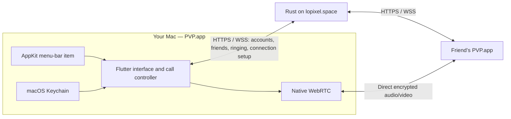

# PVP for Mac

PVP is a compiled Flutter desktop app. Swift/AppKit supplies the menu bar, window lifecycle, macOS alerts, login items, wake/network callbacks, and Keychain storage. The Rust VM service supplies accounts, accepted friendships, presence, call invitations, and signaling. Native WebRTC transports encrypted audio and video directly between clients.



The app uses the existing service without a server migration. The optional website shares accounts and friendships and interoperates with the Mac app. It is a separate client; PVP.app does not contain a webview.

## Daily behavior

1. Open PVP and sign in or create an account. Credentials persist through a Keychain session; passwords are never saved locally.
2. Add a friend by username. They accept in Requests before either person can call.
3. Click Call in People or choose the friend from the native menu-bar menu.
4. The recipient hears a ring, gets an incoming-call window, and can answer or decline. If they have enabled macOS alerts, the notification has the same actions.
5. Camera and microphone start only on calling, answering, or explicitly starting a device test. Hangup, decline, logout, cancellation, and sleep release media.
6. Closing the red window button or choosing Keep in menu bar hides the window and Dock icon. The Flutter engine and authenticated WebSocket remain running. Open PVP from the menu to bring the window back.
7. Enable Launch at login in Settings after installing the app in Applications. macOS may require approval under System Settings → General → Login Items. Login launches hide the window.
8. Choose Quit PVP to terminate. Quitting, sleep, and loss of connectivity make you unavailable; on wake or network recovery the resident app reconnects automatically.

The listening activity prevents App Nap while online and allows normal system sleep. It does not keep the Mac awake. A call can be answered if the recipient reconnects during its 60-second ring window. Otherwise it appears as missed in Recent calls.

## Quality and devices

| Preset | Capture target | Video cap | Audio cap |
| --- | --- | --- | --- |
| Data saver | 360p, 15 fps | 400 kbps | 24 kbps |
| Balanced | 720p, 30 fps | 1,800 kbps | 64 kbps |
| Studio | 1080p, 30 fps | 4,000 kbps | 96 kbps |

Custom settings allow 360p–1080p, 15–60 fps, 128–8,000 kbps video, and 24–96 kbps audio. Quality is saved separately per account and service. The in-call quality panel changes outgoing limits live. Resolution/frame-rate changes replace the capture tracks because the native plugin does not implement video `applyConstraints`; microphone/camera mute state is preserved. Hardware may provide a lower capture format.

Bandwidth caps describe outgoing encoded payload. Incoming traffic depends on the friend's settings; transport overhead is additional. Live statistics show sent bitrate, resolution/frame rate, latency, and duration. No TURN server is configured. Relay candidates are rejected, and selected candidate-pair stats are checked. Direct connectivity can fail on restrictive NAT/firewall combinations.

Settings includes camera, microphone, and speaker selection, explicit device testing, microphone activity, privacy-settings links, native alert permission, incoming sound, and launch at login. Device selection is also available in Call settings. Microphone changes keep the current track and mute state. Closing a device-test window or leaving Settings stops the test. Camera/microphone permissions are requested by macOS when capture begins. See [audio troubleshooting and validation](AUDIO.md).

## Build and run

Requirements: macOS 13+, Flutter 3.41+ / Dart 3.11+, Xcode command-line tools, CocoaPods, and Rust for local service development. Dependency versions are pinned in `pubspec.lock` and `macos/Podfile.lock`.

```sh
scripts/build-macos.sh
open dist/PVP-macOS-1.0.3/PVP.app
```

Use `PVP_FLUTTER` to choose a patched SDK, or the isolated `.build/flutter-security-sdk` when present. The script enforces `pubspec.lock` and creates `dist/PVP-macOS-1.0.3/PVP.app` and `dist/PVP-macOS-1.0.3.zip`. Install the app in `~/Applications` or `/Applications` for normal use and before enabling launch at login.

```sh
mkdir -p ~/Applications
ditto dist/PVP-macOS-1.0.3/PVP.app ~/Applications/PVP.app
open ~/Applications/PVP.app
```

The Rust `pvp` launcher searches `PVP_APP`, `~/Applications/PVP.app`, `/Applications/PVP.app`, the packaged app, and the local release build. It no longer opens a browser by default. `pvp --web` explicitly opens the optional website.

Local service and native development:

```sh
cargo run --manifest-path signaling/Cargo.toml
# In another terminal:
cd desktop
../.build/flutter-security-sdk/bin/flutter run -d macos --dart-define=PVP_SERVICE=http://localhost:8787
```

The sign-in screen also supports changing service. HTTPS is required except on loopback. Accounts belong to the chosen service. Changing service requires signing out. One client per account is active at a time; another Mac/browser takes over and interrupts an existing call.

## Validation

```sh
cd desktop
../.build/flutter-security-sdk/bin/flutter analyze
../.build/flutter-security-sdk/bin/flutter test
# From repository root:
npm run test:native
```

On October 3, 2026, the suite passed against both an isolated local service and the live HTTPS service at `lopixel.space`; temporary production verification accounts were removed and SQLite integrity remained valid. The installed signed release also opened successfully with its native window and menu-bar item.

The October 4 inspector update passes Flutter analysis, ten model/cancellation/layout/security/audio/inspector checks, and native compatibility integration with live endpoint assertions. The optional physical microphone test is blocked by macOS denying microphone permission; see [the audio release record](AUDIO.md). The [Connection inspector](CONNECTION-INSPECTOR.md) reports actual selected candidates and the live signaling socket and provides independent capture filters.

The native suite compiles and runs the actual Mac app alongside Chromium and an isolated Rust service with disposable accounts. It verifies Keychain storage/deletion, accepted friend updates, hidden-window availability, incoming ringing without capture, real native/browser WebRTC connections in both directions, native video frames and inbound RTP, absence of relay candidates, hangup cleanup, capture cancellation, reconnection, and per-account preferences. Screenshots under `docs/screenshots/native-*.png` are rendered from that app, using test accounts.

The test peer generates real browser audio/video tracks. The native test injects an empty local stream to avoid requesting physical-device permission; native outgoing capture, encoder caps, device switching, native notification permission/actions, login-item approval, and calls between external networks require manual verification on the intended Macs. They are implemented but these device/system interactions are not claimed as automatically verified.

## Distribution and fully quit app notifications

The universal 1.0.3 release (Apple Silicon and Intel) is development-signed with the available Apple Development identity and is installed in `~/Applications/PVP.app`. Previous installed apps and the 1.0.0/1.0.1/1.0.2 archives are backed up. Existing versions use the current server protocol. Quit PVP before installing a different copy. See [the inspector release](CONNECTION-INSPECTOR.md), [audio release](AUDIO.md) and [security review](SECURITY.md). Seamless distribution requires a **Developer ID Application** identity and notarization credentials. The certificate currently available on this machine is an Apple Development certificate; it is not a Developer ID distribution certificate. The build script accepts `PVP_SIGNING_IDENTITY` and signs embedded frameworks plus the app while preserving required entitlements. Notarization is a separate release step; this build is not notarized.

The app uses local notifications while its menu-bar process runs. **APNs for an entirely quit app is not implemented or configured.** That feature requires an Apple push-capable app identifier, signing/provisioning, an APNs authentication key, device-token registration, and server push delivery. No APNs key was found during setup. APNs would carry a call invitation only; call media would still use direct WebRTC after the app launches. Sleep/offline limitations would remain.

## Source map

- `lib/core/api.dart`: authenticated HTTPS and WebSocket protocol, validated service origins.
- `lib/core/controller.dart`: accounts, friendships, serial signaling, reconnects, call lifecycle, account-scoped settings.
- `lib/core/media.dart`: native capture, peer connections, ICE buffering, bitrate limits, device replacement, stats, cleanup.
- `lib/core/native.dart`: typed Flutter method-channel interface.
- `lib/ui/app.dart`: sign-in, people, requests, history, settings, and call interface.
- `macos/Runner/MainFlutterWindow.swift`: AppKit menu/window behavior, Keychain, notifications, login items, wake/network events.
- `macos/Runner/AppDelegate.swift`: resident lifecycle and graceful quit.
- `integration_test/native_call_test.dart`, `scripts/test-native.mjs`: native/browser integration harness.

Live bandwidth now displays this device's total call upload and download plus an estimated MB/min at the current rate. Group totals add every peer transport, including audio and forwarded video/data, without adding RTP counters again. Measurements use successive WebRTC transport counters (selected-pair counters as a fallback); new paths, counter resets and stale samples display “measuring” until a fresh rate is available. These are app connection statistics, not a cellular billing meter; signaling and IP/network overhead may be additional.

**Connection info & bandwidth** retains endpoint diagnostics and adds independent receive/send video limits for each participant's camera and screen share. Automatic, 64 Kbps through 8 Mbps presets, and custom 32–8000 Kbps limits apply live for the current call and survive group-link reconnection. Incoming limits are requested over the encrypted control channel; older senders may not support them, which the modal indicates. A sender's explicit per-connection cap takes precedence over a higher receive request; otherwise a receive request overrides automatic video allocation. Audio remains under the existing audio setting. Quality and throughput still depend on capture and network conditions. Explicit limits use direct RTP encoding rather than the shared encoded forwarding path, so independent viewers can receive different rates; some group forwarding savings are lost while overrides are active.
