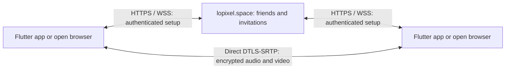

# Security review — October 3, 2026

The October 3 review shipped signaling 0.3.0 and Flutter 1.0.1. Original Flutter 1.0.0 clients continue using the same authenticated protocol. The installed app and original release archive were preserved for that release. October 4 updates added [audio fixes](AUDIO.md) and the [Connection inspector](CONNECTION-INSPECTOR.md), now in installed Flutter 1.0.3 and signaling/browser 0.3.2. The findings and checks below describe the security release.

## Encryption and trust



Audio/video use WebRTC DTLS-SRTP across browser–browser, browser–native and native–native calls. The service carries SDP/ICE and invitations, rather than media. Updated clients and the service require SHA-256 certificate fingerprints and encrypted `UDP/TLS/RTP/SAVPF` media, reject SDES keys/plaintext RTP, and reject TURN/relay candidates. WebRTC checks the negotiated certificate during DTLS. Account traffic and setup use TLS; native service URLs require HTTPS except for loopback development.

New clients display matching 96-bit certificate verification codes. Compare all six groups using an independent trusted channel; a mismatch means different peer certificates and should prompt hanging up. The canonical input is `PVP-call-v1\n` followed by sorted, unique, lowercase SHA-256 fingerprints without colons, separated by newlines. Its SHA-256 digest is truncated to 24 hexadecimal characters. This is a call certificate check, not a persistent account identity or an automatically verified badge. Original clients remain encrypted without displaying the code.

The service remains trusted for account identity and initial certificate delivery. A compromised signaling server could substitute certificates and attempt a man-in-the-middle attack; independent code comparison helps detect substitution. A compromised web origin could serve JavaScript that captures plaintext at the endpoint. PVP does not promise protection against compromised endpoints or signing keys. The service sees participants, presence, timing, SDP and setup addresses; peers and STUN services see network addresses. PVP does not record media, but participants can.

The encryption architecture follows [RFC 8827](https://www.rfc-editor.org/info/rfc8827/) and [WebRTC's SRTP implementation](https://webrtc.googlesource.com/src/+/HEAD/pc/g3doc/srtp.md). Direct connections can fail on restrictive NAT/firewalls; no media relay fallback is configured.

## Findings addressed

| Finding | Fix and validation |
| --- | --- |
| Browser permission requests survived cancellation; termination waited behind capture | Capture generations stop late tracks; terminal events run immediately. Both outgoing and incoming pending-permission cancellation are tested. |
| Stale sockets or asynchronous results could affect another call/account | Account, socket, call and capture guards; cleanup invalidates pending work. A delayed initial session check cannot undo a completed sign-in; the race is regression tested. |
| Unstructured SDP/candidates and unbounded ICE processing | Encrypted profiles and fingerprint validation, caller-offer/callee-answer roles, no replayed SDP, candidate shape/index limits, 128 candidates per participant and bounded client queues. Adversarial tests cover malformed/plaintext/relay/flooded signals. |
| Revoked sessions could mutate calls until heartbeat | Session authentication on every text command; serialized revocation and call/friend mutations. Logout immediately closes its authenticated socket. |
| Logging out an old session disconnected another device | Live connections record a session hash; only the matching session is closed. Regression tested. |
| Friendship removal raced call creation | Call mutations and removal share an operation lock; removal terminates the call and prevents further setup. |
| Acceptance could occur after ring expiry before cleanup | Acceptance itself enforces the 60-second deadline. Rust regression tested. |
| Unknown usernames bypassed password verification | Dummy Argon2 verification and generic login failure; public registration still reveals username availability. |
| Password hashing could queue without a bound | Two immediate permits; excess work returns 429. Blocking work retains its permit even if the request is canceled. |
| Slow writes could suppress liveness checks; limiter state was unbounded | Five-second sends, three-second close, bounded queues, 256 concurrent sockets, frame/message/body limits, HTTP/action/call rate limits and bounded limiter storage. |
| Security headers were absent on early errors | CSP, no-store, no-referrer and nosniff also protect origin/rate failures. Tested on rejected requests. |
| Native WebSocket redirects could forward session cookies | Non-redirecting RFC 6455 handshake, secure random nonce, accept-header validation and timeout cleanup. Test confirms no request reaches a redirect destination. |
| Native response size and cookie format were unrestricted | 256 KiB response limit, bounded reading, validated 64-hex tokens and cookies committed only after successful responses. |
| Native release failures could skip remaining track cleanup; capture could overlap | Every peer/track cleanup is attempted; capture is deduplicated and invalidated on stop. |
| Flutter/Dart package extraction advisory | Isolated Flutter 3.41.0 / Dart 3.11.0 SDK; release script requires the patched SDK and enforces the package lock. |

User names render as text; a malicious-name regression test confirms no HTML execution. CSP confines scripts/resources to the origin and prevents framing. HTTP writes and socket upgrades require the configured Origin. A native program can supply any Origin, so authentication and friendship checks remain the authorization boundary. Production cookies are HttpOnly, SameSite=Strict and Secure. Passwords use salted Argon2id; session tokens are stored as SHA-256 hashes. Native sessions use device-only macOS Keychain storage after first unlock. The release is sandboxed with network/camera/microphone entitlements and no release JIT entitlement.

## Dependencies and deployment

`python3 scripts/audit-dependencies.py` queried OSV for 393 unique pinned Rust/Dart versions. It returned no advisories for signaling or Flutter package dependencies. `npm audit` returned zero vulnerabilities. Public flutter-webrtc and webrtc-sdk security-advisory lists returned no published advisories. The native engine uses flutter_webrtc 1.6.2+hotfix.3 and WebRTC-SDK 150.7871.01. Advisory databases do not establish that native binaries or browsers have no vulnerabilities.

The SDK finding is [GHSA-q739-79rh-vmvp](https://github.com/dart-lang/sdk/security/advisories/GHSA-q739-79rh-vmvp), patched in Dart 3.11.0 / Flutter 3.41.0. The system Flutter installation and other Flutter projects were unchanged. PVP's patched SDK is `.build/flutter-security-sdk`; `PVP_FLUTTER` selects another patched SDK.

The optional Rust UDP client's lockfile had bytes/rand advisories; compatible patches updated bytes to 1.11.1 and rand to 0.8.6/0.9.3. Remaining legacy-only findings are ringbuf 0.4.8 ([RUSTSEC-2026-0293](https://rustsec.org/advisories/RUSTSEC-2026-0293.html)), unmaintained audiopus_sys and unmaintained paste. These are excluded from the default launcher, Flutter and signaling builds. Current legacy ring buffers hold `f32`, which has no panicking destructor, so the reported destructor-panic trigger is absent in this usage. The separate custom AES/UDP protocol was not redesigned or certified by this review and does not interoperate with WebRTC. Its transport/dependency upgrade needs a separate compatibility review.

Production signaling binds loopback, runs as unprivileged `pvp`, and has systemd filesystem/home/device restrictions, NoNewPrivileges and a 150 MiB cap. Database directory/file modes are 0700/0600; the root-owned environment file is 0600. Caddy provides HTTPS/renewal with a loopback admin listener. Installed Ubuntu Caddy, OpenSSL and OpenSSH versions matched their configured apt candidates at inspection. Existing game/legacy relay services stayed active. This was an application review, not an independent audit of those services or the entire OS.

The server was staged with an SQLite backup and rollback binary and updated when no signaling clients were connected. The schema and required protocol fields were retained. Protected rollback artifacts are in `/var/backups/pvp/security-2026-10-03`. Production health is 0.3.0, SQLite integrity is `ok`, and only explicitly named verification and diagnostic accounts were removed.

## Validation and practical limits

- Five Rust authorization/history/expiry/encryption tests passed. Strict signaling and launcher clippy passed.
- Thirteen browser/security scenarios passed locally, including real generated-media WebRTC, DTLS/SRTP ciphers, matching codes, direct ICE, quality/mute/cleanup, late permission cancellation, delayed arrival, layout, XSS/CSRF, unauthorized call control, unsafe/replayed/flooded signals, friendship removal and session revocation.
- Six Flutter model/layout/cancellation/encryption/redirect checks passed; analysis is clean.
- Native integration passed locally and in production: hidden-window ringing, accepted friends, real browser video rendered natively, both call directions, DTLS/SRTP ciphers, matching codes, cleanup/reconnect/Keychain and two native controllers establishing a direct encrypted transport with matching codes.
- An unchanged Flutter 1.0.0 snapshot also passed both browser call directions against updated local and production signaling. The production browser suite passed all five scenarios; authentication, encrypted media calling and the delayed-session regression also passed after the final static Linux binary was deployed.

Browser tests generate real audio/video tracks. Native tests receive them and inject empty local streams to avoid physical device permissions. The native–native test adds an encrypted data channel to exercise DTLS without hardware capture. Native outbound camera/mic capture, Safari/Firefox, separate external networks, notification actions and login-item approval remain manual checks.

Browser invitations require an open page/socket. Audible ringing needs browser audio permission/user activation; Enable call sound is available. Notifications are optional. Closing the page ends its calls/capture; returning during an existing 60-second invitation can still ring. The Mac app remains available with its window hidden; quitting, sleep or offline status stop availability. APNs wake-from-quit is not implemented. The existing one-active-client-per-account behavior remains.

Flutter 1.0.1 is packaged separately at `dist/PVP-macOS-1.0.1/`; the installed app and original archive are preserved. It is development-signed and not notarized. Quit a running PVP copy before opening/installing a different version.

```sh
cargo test --manifest-path signaling/Cargo.toml
cargo clippy --manifest-path signaling/Cargo.toml --all-targets -- -D warnings
cargo clippy --all-targets -- -D warnings
npm test
npm audit
python3 scripts/audit-dependencies.py
.build/flutter-security-sdk/bin/flutter analyze desktop
cd desktop && ../.build/flutter-security-sdk/bin/flutter test test
# From repository root:
npm run test:native
PVP_SIGNING_IDENTITY='your certificate identity' scripts/build-macos.sh
```

## Audio follow-up — October 4, 2026

Flutter 1.0.2 and signaling/browser 0.3.1 retain the authenticated protocol, encrypted media requirements and strict direct P2P policy. The audio meter retains only a scalar level; it creates no audio recording or additional network stream. Capture permission and cancellation guards still apply. The native outbound-audio test fixture is debug-only and was verified absent from the distributed release binary.

Fourteen local browser/security scenarios, five production browser scenarios, seven Flutter checks, Flutter analysis, the Rust launcher check and native compatibility integration passed. The added regressions cover failed track-replacement rollback, audio activity after mute/device changes, autoplay recovery and preserving credentials during initial session failure. Physical native outbound audio could not be verified because macOS denied microphone access. See [the complete audio release record](AUDIO.md) for artifacts, checks and rollback locations.

## Connection inspector follow-up — October 4, 2026

The inspector uses allowlisted WebRTC statistics and the native live signaling socket. It never converts aggregate counters into synthetic packet rows or resolves a hostname to invent an active socket tuple. Hidden addresses and ambiguous selection remain unavailable. Capture commands accept only validated literal IPs, bounded numeric ports and fixed protocols; they are copied for independent execution, not passed to a privileged helper. Endpoint strings render as text, without HTML interpretation.

Media observations and the bounded event timeline remain in memory and clear on teardown. JSON reports exclude credentials, cookies, SDP and media. Native saving adds only user-selected file access to the existing sandbox; it does not enable broad filesystem access or packet-capture privileges. Screenshots with actual network addresses are kept in the ignored build directory. Encryption, session handling, friendship authorization and the protocol/schema are unchanged.

Seventeen local browser/security cases, ten Flutter checks, analysis, five Rust signaling tests, strict signaling clippy and native interoperability/inspector checks passed. The feature reports evidence from the running app and provides independent capture filters; it does not promise that a compromised app cannot forge its own display. See [the inspector record](CONNECTION-INSPECTOR.md) for release and production validation.

## Local red-team follow-up — October 11, 2026

See [the current local review](RED-TEAM-2026-10-11.md) for signaling availability and connection-race fixes, authenticated legacy UDP packets, bounded relay socket lifetimes, and the ringbuf upgrade. These are source changes; the historical deployment and release claims above do not describe a new deployment.

The follow-up also covers [authentication and database storage](RED-TEAM-2026-10-11.md#authentication-credentials-and-sqlite-follow-up): private Unix database/journal files independent of umask, a per-account login budget, and portable backups that omit sessions. SQLite/backups are still unencrypted; the report distinguishes password hashing and token hashing from whole-database encryption and records missing account-recovery controls.

## Live connection proof — October 31, 2026 (local source)

The call's **Connection evidence** panel separates observed encryption from a person's independent certificate-code comparison. It reports **Encryption observed** only when the current peer connection is connected, each evaluated transport has a connected DTLS state and an observed cipher, media transports report an encrypted SRTP profile, and both reported SHA-256 certificate fingerprints match their negotiated SDP. It separately reports whether an explicitly selected, succeeded ICE pair uses direct candidates on both ends. Configured STUN servers, a nominated historical candidate pair, or an account name do not prove the selected route or a person's identity.

Unsupported or absent statistics display **unavailable**; a connecting or interrupted peer displays a waiting state. These states do not assert that plaintext media is being sent. A certificate mismatch, relay path, or failed/closed DTLS state on an explicitly selected transport is a definite failed check. Clients reject that connection. Historical unselected transport rows cannot cause a false security failure. No cipher names, fingerprints, addresses, or successful states are invented. The browser evidence view excludes SDP, credentials, raw certificate data and network addresses; the existing detailed inspector remains available separately.

The positive media check recognizes encrypted AES-CM and AES-GCM SRTP profiles, including current `SRTP_AES128_CM_HMAC_SHA1_80` and older `AES_CM_128_HMAC_SHA1_80` spellings. It keeps the engine's original cipher string in the evidence. Unknown profiles remain unavailable and nonfatal; an explicitly reported NULL/plaintext profile is rejected. The recognized names follow the [IANA DTLS-SRTP registry](https://www.iana.org/assignments/srtp-protection) and [libwebrtc's cipher names](https://webrtc.googlesource.com/src/+/main/rtc_base/ssl_stream_adapter.cc). This inspects the existing WebRTC implementation; it does not introduce a new media-encryption protocol.

Security failures take the leave/hangup path that stops local capture, rather than the interrupted-meeting path that can preserve consent for reconnection. Native media teardown begins before best-effort platform ringing cleanup, so an unavailable platform channel cannot delay stopping the connection. Native aggregate evidence stays unavailable when multiple selected transports make the positive summary ambiguous, while a definite failure on any selected transport still rejects the connection.

Compare all six groups of the code with the intended participant in person or through another independently trusted channel. Comparing through this same call or its chat is not an independent check. **Codes compared** records only the user's acknowledgement for that peer connection and current code. It expires when the panel closes or the peer connection/certificate changes; it never becomes a verified account badge. Browser–native comparison retains the existing `PVP-call-v1` canonical input and 96-bit display format. Validation now requires valid encrypted SDP and exactly one distinct SHA-256 fingerprint independently from each endpoint before producing a pair code. This prevents unused extra fingerprints from padding two different endpoint sets into an equal union. Multi-certificate negotiations can still provide encrypted-transport evidence, but cannot produce this pair code.

This is evidence reported by the current WebRTC implementation, not an independent audit. A compromised web origin can replace the code and its display. A compromised endpoint can access media; participants can record outside PVP. The service still sees invitation/setup metadata and connection addresses, while media travels between participants. For larger supported groups, encoded video can be forwarded by another participant; the transport proof covers each immediate peer connection, not a new audit of the separate signed/encrypted video-overlay format.

For a check outside the product UI, open Chromium's `chrome://webrtc-internals` before a call and inspect its selected candidate-pair, transport, DTLS/SRTP cipher, and certificate reports. Those are browser observations; a packet capture can demonstrate encrypted network traffic but cannot by itself establish who holds the other endpoint or whether a device is compromised. The relevant definitions are [W3C WebRTC statistics](https://www.w3.org/TR/webrtc-stats/) and [RFC 8827's WebRTC trust model](https://www.rfc-editor.org/rfc/rfc8827.html#section-3).

`npm run test:security-proof` exercises canonical-code compatibility, independent per-endpoint validation, bounded direct ICE candidates, missing/ambiguous observations, certificate substitution, lost DTLS, capture-free real Chromium audio connections, and comparison-state expiry. It requests no physical microphone or camera. This follow-up changes local source; the historical production/release statements above do not imply deployment of these changes.
