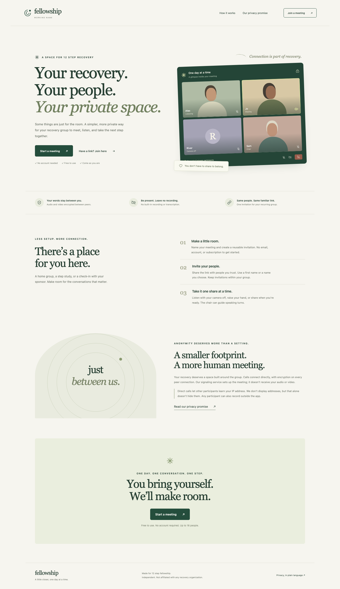

# Fellowship — working name

A separate browser app for small 12 step recovery groups, built on PVP's encrypted direct-call core. The name and domain are provisional.

```sh
npm run dev:recovery
# Open http://localhost:8787
```

The app also runs at `/recovery/` on a normally configured PVP service. `PVP_RECOVERY=1` puts the recovery landing page at `/`. Rebuild the signaling binary after changing frontend files because assets are embedded. Deploy a new instance with its own database and domain when the product is ready; the existing native PVP app is a separate client.

The development command uses `fellowship.sqlite` by default, separate from PVP's usual database. Set `PVP_DATABASE` to override it.

## Meeting experience

- No account, email, public profile, friend directory, or call history in the recovery app.
- Create a recurring invitation, share it privately, and return using the same link.
- First names or chosen names. Recovery session cookies are separate from ordinary PVP cookies, so a PVP account never silently supplies a real name.
- Join to listen without requesting camera or microphone access. Microphone joins start muted; cameras are always opt-in.
- Chair-guided sharing enabled by default. Members raise hands; the chair approves or ends turns. Approval leaves the member muted until they choose to unmute. Receivers enforce moderation too.
- Chairs can remove participants. The underlying service blocks that guest session from returning; anyone with a link can create a fresh browser identity, so removal is not a permanent identity ban.
- Encrypted voice and optional video for up to 16 participants. Direct meshes work best for small groups.
- Peer certificate codes can be compared through a separate trusted channel from the participant list.
- No recording, transcription, file attachments, analytics, third-party fonts, or remote image dependencies in this interface.
- Leaving, cancellation, connection loss, and replacement in another tab stop local capture and close peer connections.

Chair identity is stored in a persistent HttpOnly browser session. This is an accountless persistent server identity, not a claim of zero stored data. Clearing browser site data or losing the session loses chair controls; keeping the invitation still permits ordinary guest entry. Existing chair names are reused and shown before joining.

## Privacy promises and limits

**Product decision: retain direct P2P; remove address displays and exports; disclose peer IP visibility.**

The app provides no network inspector, IP address display, address export, or packet-capture commands. This does **not** hide network addresses from other participants. WebRTC peers need connection addresses to communicate. This is disclosed on the landing page, in the join agreement, and in the privacy dialog. A relay-only design would require a different transport policy and funded infrastructure.

Each connection uses WebRTC DTLS-SRTP. TURN configuration and relay candidates remain rejected by the existing shared core and signaling validators. Signaling exchanges connection information and sees setup metadata; it does not receive call audio or video. Public STUN services assist connectivity. Strict direct calls may fail on restrictive NATs/firewalls. Cross-network calls and physical media devices still need manual validation.

There is no built-in recorder or media storage feature. Another participant can record outside the app. The confidentiality agreement is a group norm, not a technical recording-prevention guarantee. Persistent data includes meeting titles, accountless host identities, host sessions, and meeting membership. Joining guests use temporary in-memory sessions. Choose non-identifying meeting titles and configure infrastructure logging/retention for the eventual deployment. No independent security audit has been completed.

Free access is the current product commitment. Direct media reduces infrastructure costs; it does not eliminate hosting, signaling, STUN, development, or maintenance costs, prove privacy, or establish perpetual funding.

Zoom offers optional end-to-end encryption. The product does not claim that all centralized video apps are insecure or that all Zoom meetings are recorded for auditing. See [Zoom's E2EE documentation](https://support.zoom.com/hc/en/article?id=zm_kb&sysparm_article=KB0075502) and [WebRTC's privacy considerations](https://www.w3.org/TR/webrtc/#privacy-and-security-considerations).

## Validation

```sh
npm run test:recovery
cargo test --manifest-path signaling/Cargo.toml
cargo clippy --manifest-path signaling/Cargo.toml -- -D warnings
```

The Playwright integration uses three isolated browser contexts, a temporary database, real peer connections, and generated audio/video. It verifies session isolation, consent, listen-only entry, encrypted media reception, speaking approval and receiver moderation, mobile layouts, leave/rejoin, device teardown, cancellation while microphone permission is pending, recovery after microphone denial, public-preview privacy, HTTP/WebSocket origin checks, and the absence of external HTTP asset requests. It never opens physical devices. Evidence is saved to `docs/screenshots/recovery-home.png`, `recovery-meeting.png`, and `recovery-meeting-mobile.png`.


